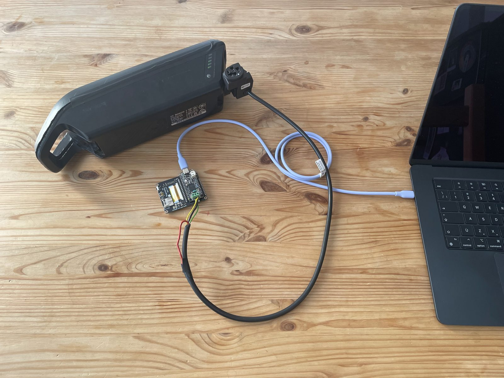
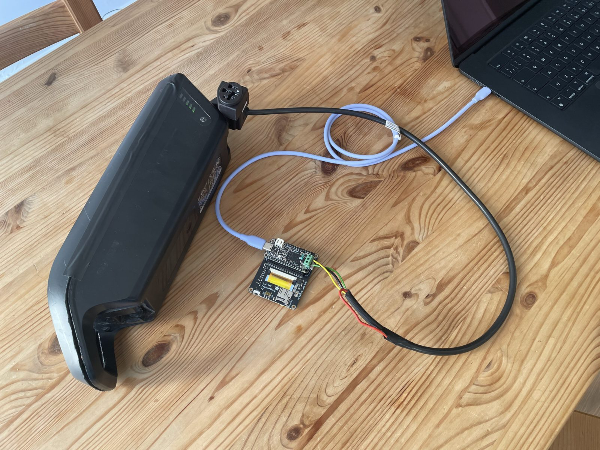
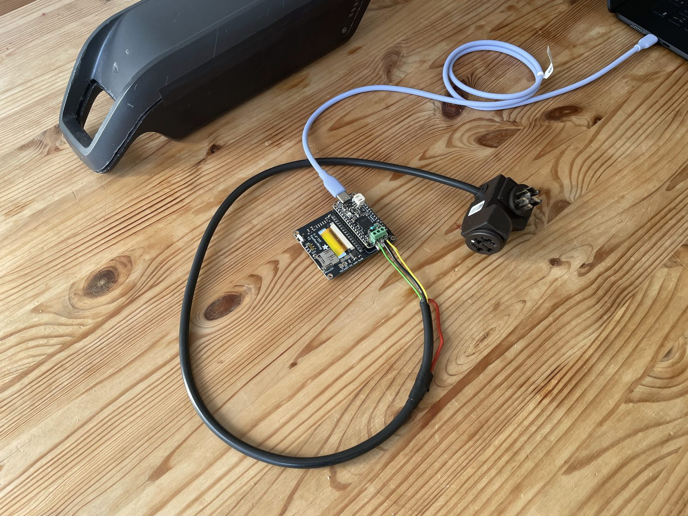
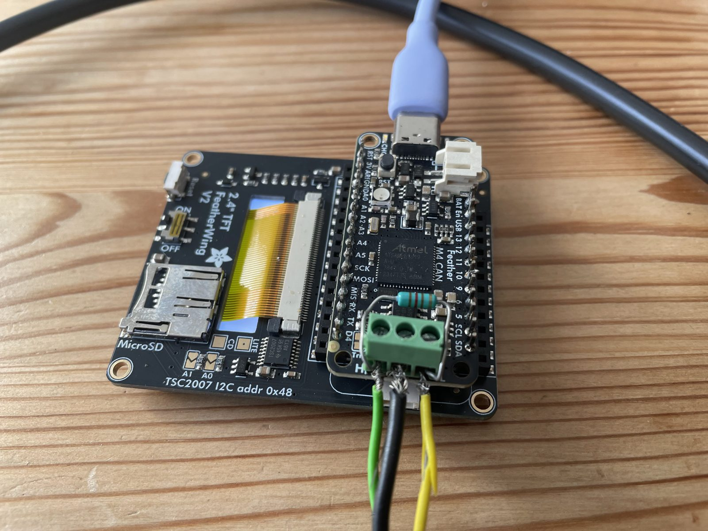

# Bosch PowerPack 400 (BES2) — CAN diagnostics

Reverse-engineering notes and tools for reading diagnostic data from a **Bosch
PowerPack Frame 400** e-bike battery over its CAN bus, using cheap hobbyist
hardware instead of the official Bosch dealer tool.

Two things live here:

1. A **passive CAN sniffer** that captured a real diagnostic session performed
   with the official Bosch software (battery on a compatible new bike).
2. A **read-only reader** that replays part of that session on its own, with no
   Bosch tool, reading fault codes, temperature and pack voltage directly from
   the BMS.

This project is **not** affiliated with or endorsed by Bosch.

## What works

Without any authentication you can read:

- **Fault codes** (for my battery, DTCs `606011`, `655003` and `61000E`, i.e.
  display codes 606 / 655 / 610, see [error codes](https://open-battery.org/docs/bosch/powerpack-bes2/error-codes/))
- **Measured temperature inside the pack**
- **Pack voltage** (and state of charge, passively)

## What does not

The BMS gates its history behind **UDS SecurityAccess (0x27)**. These stay
locked (`NRC 0x33`, securityAccessDenied) and were **not** recovered:

- Charge-cycle count
- Total Ah discharged
- Min / max recorded temperatures

Requesting a seed (`27 11`) returns a 16-byte challenge; the seed→key algorithm
is unknown, so the matching key (`27 12`) was never sent. If you crack that, the
rest of the DIDs listed in [`docs/protocol.md`](docs/protocol.md) should open up.

## Hardware

- **Adafruit Feather M4 CAN Express** (ATSAME51 + built-in CAN transceiver)
- CircuitPython, `canio` module
- CAN bus at **500 kbit/s**, tapped on the pack's CAN-H / CAN-L

No extra transceiver or shield is needed, the Feather M4 CAN has one onboard.
(Mine has a 2.4" TFT FeatherWing attached underneath; it plays no role here.)

### Connecting to the battery

I used a **Bosch Rear Rack Cable 720 mm – BDU2XX / BDU3XX / BDU4XX – BCH222**,
cut at one end. The intact connector plugs into the battery; the CAN wires from
the cut end go to the Feather's CAN terminal block. No need to switch the
battery on: starting the reader wakes it up.

If you'd rather not sacrifice a cable, others have 3D-printed a battery
connector with CAN pins instead:
[Bosch 36V eBike battery connector with CAN pins (Printables)](https://www.printables.com/model/1117202-bosch-36v-ebike-battery-connector-with-can-pins-5/files).

| | |
|---|---|
|  |  |
|  |  |

A sample run on this setup is in
[`data/reader_output_my_battery.txt`](data/reader_output_my_battery.txt).

## Layout

```
firmware/
  sniffer/   passive CAN logger (never transmits)     → firmware/sniffer/README.md
  reader/    read-only diagnostic replay              → firmware/reader/README.md
tools/
  decode.py  decode sniffer .bin captures to CSV
data/
  can_0066.*            the captured Bosch diagnostic session (bin + log + csv)
  official_diag_report.pdf   official Bosch report for the same pack (anonymized)
  reader_output_my_battery.txt  real reader output on my pack (3 DTCs)
docs/
  protocol.md   CAN IDs, UDS DIDs, DTCs, the security gate, reference values
  images/       photos of the bench setup
```

## Reproduce

Sniff a session, or just decode the included capture:

```sh
python3 tools/decode.py data/can_0066.bin /tmp/out.csv
```

To talk to a pack yourself, flash `firmware/reader/code.py` and open the serial
console - see [`firmware/reader/README.md`](firmware/reader/README.md). Start
from the sniffer if you want to capture your own reference session first.

## Safety & scope

- The sniffer is strictly passive and safe to leave on a live bus.
- The reader only reads. It never writes, clears, resets, or sends a
  SecurityAccess key.
- All findings come from **one** pack / firmware / bike. IDs and offsets may
  differ on yours. Verify before trusting any value.
- Work on your own battery, at your own risk.

## Contributing

Everything here comes from a single battery, so the most useful help is more
data. Contributions are very welcome, in particular:

- **Other models.** Run the reader (or the sniffer) on other Bosch batteries,
  e.g. PowerPack 300/500, PowerTube, or other generations, and report what works:
  bit rate, CAN IDs, which DIDs answer and which are locked. Please include the
  battery part number and the serial output.
- **DTCs.** Share the fault codes your pack returns, ideally alongside what the
  official Bosch tool or a dealer reports for them. The first three digits map
  to the display code, but the meaning of the last three (e.g. `011` in
  `606011`) is still unknown.
- **UDS decoding.** Help confirm or correct the DID decodings in
  [`docs/protocol.md`](docs/protocol.md), especially the ones marked as
  hypotheses (Ah, cycles, `0x108`), and map DIDs not covered yet.

Open an issue or a pull request with your captures and findings. Feel free to
redact serial numbers.

## License

[MIT](LICENSE) © 2026 Bruno Godefroy
